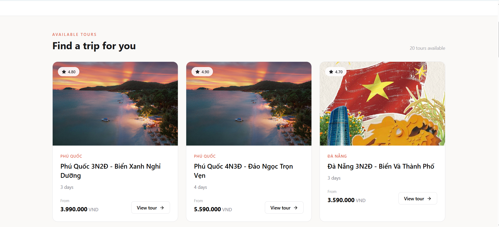
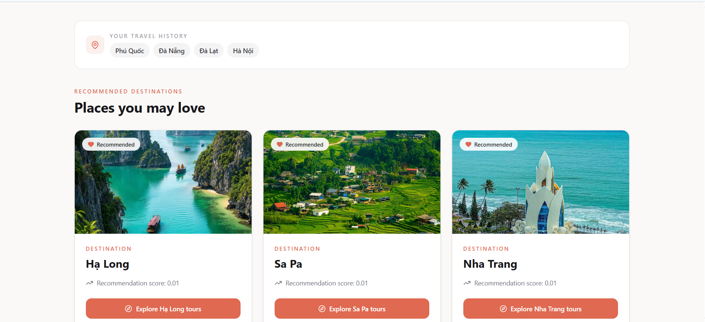
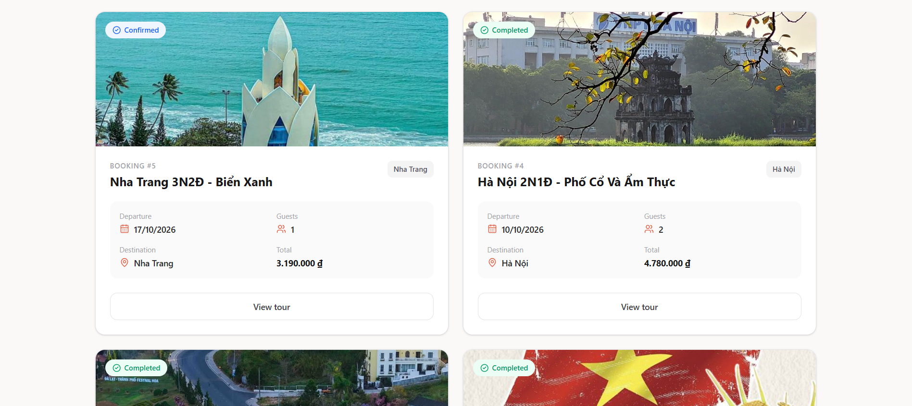
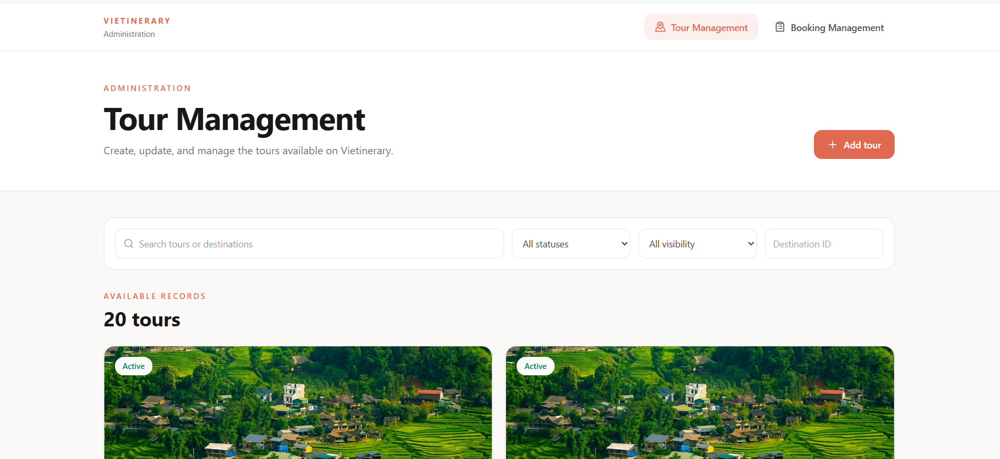
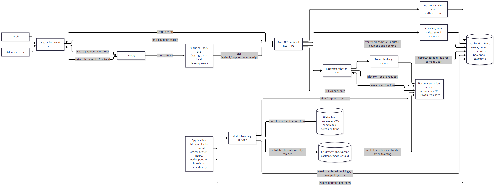

# Vietinerary — Vietnam Tourism Recommendation Platform

Vietinerary is a full-stack tourism platform for discovering Vietnamese destinations, exploring tours, managing bookings, and receiving personalized travel recommendations. Its recommendation API uses an FP-Growth model trained on historical travel transactions and eligible completed bookings from the application database.

> **Project status:** Academic/prototype project. The application currently uses SQLite and local application-level background tasks. Review the deployment and security requirements before using it in production.

## Contents

- [Highlights](#highlights)
- [Screenshots](#screenshots)
- [System architecture](#system-architecture)
- [Technology stack](#technology-stack)
- [Repository structure](#repository-structure)
- [Getting started](#getting-started)
- [Configuration](#configuration)
- [Recommendation model](#recommendation-model)
- [API overview](#api-overview)
- [Future work](#future-work)

## Highlights

### Traveler experience

- Browse destinations and explore available tours.
- Register, sign in, and view an account profile.
- View personalized destination recommendations based on completed-trip history.
- Create, view, and cancel bookings.
- Pay for bookings through the VNPay integration and check payment status.

### Administration

- Manage tours, including creating and editing tour information and changing tour availability.
- Review bookings, filter booking records, and mark eligible bookings as completed.

### Recommendation and model training

- Generate recommendations with FP-Growth frequent itemsets and suffix-pattern backoff.
- Rank candidate destinations deterministically and exclude destinations already present in the travel history.
- Load the active model checkpoint into memory rather than rerunning FP-Growth for every recommendation request.
- Attempt model retraining at application startup and then hourly.
- Combine the historical processed CSV with live bookings whose status is `COMPLETED`; the training process reads these bookings from the database and does not append them to the CSV.
- Validate a newly generated checkpoint before replacing the active checkpoint. If training fails, the existing model remains available.
- Periodically expire eligible pending bookings.

## Screenshots

Add screenshots under `docs/images/`, then uncomment and update the corresponding Markdown image links below. Avoid including personal information, payment credentials, or other sensitive data in screenshots.








## System architecture



For the Mermaid source and additional flow notes, see [the system architecture document](docs/system-architecture.md).

## Technology stack

| Area | Technologies |
|---|---|
| Frontend | React, Vite, React Router, Tailwind CSS |
| Backend | Python, FastAPI, Pydantic, SQLAlchemy |
| Database | SQLite for the current local setup; Alembic migrations |
| Recommendation | FP-Growth, pandas, mlxtend |
| Payments | VNPay payment redirect and server-to-server IPN callback |

## Repository structure

```text
.
├── backend/
│   ├── app/
│   │   ├── core/          # Configuration, database, authentication helpers
│   │   ├── models/        # SQLAlchemy models
│   │   ├── repositories/  # Data access
│   │   ├── routes/        # FastAPI endpoints
│   │   ├── schemas/       # Request and response models
│   │   └── services/     # Business logic and FP-Growth training
│   ├── alembic/           # Database migrations
│   ├── data/
│   │   └── processed/     # Historical training transactions
│   ├── models/            # FP-Growth model checkpoint
│   └── requirements.txt
├── docs/
│   ├── system-architecture.md
│   └── system-architecture.png
├── frontend/
│   ├── src/
│   │   ├── components/
│   │   ├── pages/
│   │   └── services/
│   └── package.json
└── README.md
```

## Getting started

### Prerequisites

- Python and Node.js/npm installed.
- A VNPay sandbox account and callback URL if you want to test the payment flow.
- The historical training dataset and a valid model checkpoint in the locations shown in the repository structure. The training task also requires access to the application database.

### 1. Configure and start the backend

Open PowerShell at the repository root:

```powershell
cd backend
python -m venv .venv
.\.venv\Scripts\Activate.ps1
python -m pip install -r requirements.txt
Copy-Item ".env .example" ".env"
```

Edit `backend/.env` with the settings described in [Configuration](#configuration). From the `backend` directory, apply database migrations and start the API:

```powershell
alembic upgrade head
uvicorn app.main:app --reload
```

The backend is available at `http://127.0.0.1:8000`. Interactive API documentation is available at `http://127.0.0.1:8000/docs`.

### 2. Start the frontend

Open a second PowerShell window at the repository root:

```powershell
cd frontend
npm install
npm run dev
```

Open the local URL printed by Vite, usually `http://localhost:5173`. The frontend currently sends API requests to `http://127.0.0.1:8000`.

### Useful development commands

Run these commands from the `frontend` directory:

```powershell
npm run lint
npm run build
```

## Configuration

The backend reads its settings from `backend/.env`. Never commit real secrets. Set the required values for your environment:

```dotenv
APP_NAME=Vietnam Tourism Recommendation API
APP_VERSION=1.0.0

DATABASE_URL=sqlite:///./data/app.db

JWT_SECRET_KEY=replace-with-a-strong-random-secret
JWT_ALGORITHM=HS256
ACCESS_TOKEN_EXPIRE_MINUTES=60

VNPAY_TMN_CODE=your-vnpay-terminal-code
VNPAY_HASH_SECRET=your-vnpay-hash-secret
VNPAY_PAYMENT_URL=your-vnpay-payment-url
VNPAY_RETURN_URL=http://localhost:5173/payment/result
VNPAY_IPN_URL=your-public-backend-ipn-url

PAYMENT_EXPIRE_MINUTES=15
PAYMENT_EXPIRY_CHECK_INTERVAL_SECONDS=60
```

Use the VNPay URLs and credentials issued for your own sandbox or production account. VNPay must be able to reach the configured IPN URL; local development typically requires a public tunnel. Do not expose or commit `.env` files.

## Recommendation model

The model training service reads completed historical transactions from `backend/data/processed/Vietnam_TourBookings_Filtered_V1.csv` and groups eligible live `COMPLETED` bookings by user. `CONFIRMED` bookings are not included until their status becomes `COMPLETED`.

At startup, and approximately once per hour while the backend process is running, the application attempts to:

1. Load the historical and live transactions.
2. Mine frequent itemsets using the model's configured FP-Growth parameters.
3. Validate the generated checkpoint.
4. Atomically replace the checkpoint and activate the new model in memory.

The CSV remains unchanged; live bookings are read from the database for each training run. Check the backend logs and `GET /model-info` to inspect the latest training metadata. A failed training run is logged and does not replace the last valid checkpoint.

> The hourly task runs inside the application process. Running multiple backend instances can trigger duplicate training jobs; production deployments should use a single scheduler or a dedicated job queue.

## API overview

The complete interactive schema is available at `/docs` while the backend is running.

| Method | Endpoint | Purpose |
|---|---|---|
| `GET` | `/api/v1/health` | Check API availability and recommendation algorithm |
| `GET` | `/api/v1/model-info` | Inspect metadata for the active FP-Growth model |
| `POST` | `/api/v1/recommendations` | Get recommendations for a supplied destination history |
| `GET` | `/api/v1/destinations` | List destinations |
| `GET` | `/api/v1/tours` | Browse tours |
| `GET` | `/api/v1/tours/{tour_id}/schedules` | List schedules for a tour |
| `POST` | `/api/v1/auth/register` | Register a traveler |
| `POST` | `/api/v1/auth/login` | Sign in and obtain an access token |
| `GET` | `/api/v1/auth/me` | Get the authenticated user's profile |
| `GET`, `POST`, `PATCH` | `/api/v1/bookings/...` | Create, view, and cancel traveler bookings |
| `POST` | `/api/v1/payments/vnpay/{booking_id}` | Create a VNPay payment |
| `GET` | `/api/v1/payments/vnpay/ipn` | Receive VNPay IPN callbacks |
| `GET` | `/api/v1/payments/{txn_ref}` | Check payment status |
| `GET`, `POST`, `PUT`, `PATCH` | `/api/v1/admin/tours/...` | Admin tour operations |
| `GET`, `PATCH` | `/api/v1/admin/bookings/...` | Admin booking operations |
| `GET` | `/api/v1/recommendations/me` | Get recommendations using the authenticated travel history |

Most `/api/v1` endpoints require authentication. Administrative endpoints also require an administrator account.

## Future work

The following are potential enhancements, not claims about currently implemented features:

- Add automated tests for authentication, booking/payment transitions, recommendation behavior, and training failure recovery.
- Move production deployments to a managed relational database and an external scheduler or background-job system.
- Add recommendation quality evaluation, model version history, and monitoring for training and serving.
- Add deployment automation, environment-specific configuration, and operational health monitoring.
- Expand the administrator dashboard with reporting and booking analytics.
- Improve accessibility, responsive behavior, and user-facing localization.

## License

Add the project's license and attribution details here before publishing or redistributing the repository.
