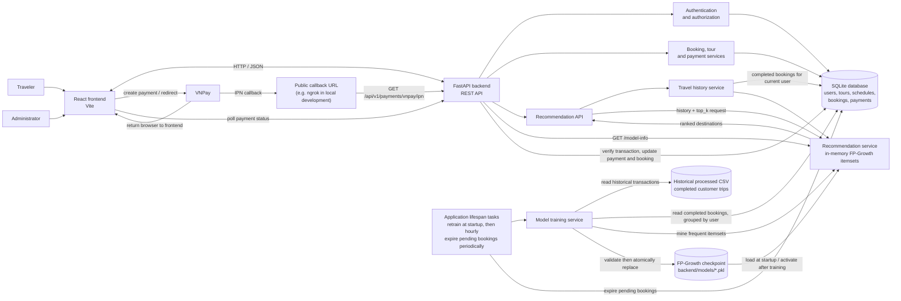

# System Architecture

**PNG diagram:** [Open system-architecture.png](./system-architecture.png)

## Component overview

## Key flows

### Recommendation and training

1. The authenticated recommendations endpoint reads the current user's completed-trip destinations from SQLite.
2. The recommendation service matches that history against the currently loaded FP-Growth itemsets and returns ranked destinations.
3. At application startup, and then after each training run plus one hour, the background task reads the historical CSV and completed bookings from SQLite.
4. The training service rebuilds the itemsets, validates the checkpoint, atomically replaces the `.pkl` file, and activates the new model in memory. A failed run leaves the previous checkpoint active.

The historical CSV is read as a training input; live completed bookings are read from the database. The training task does not append those bookings to the CSV.

### Payment

1. The frontend asks the backend to create a VNPay payment and redirects the traveler to VNPay.
2. VNPay sends an IPN callback to the backend. The backend validates the signature and amount, then marks the payment `PAID` and booking `CONFIRMED` for a successful transaction.
3. VNPay returns the browser to the frontend payment-result page, which polls the backend for the payment status. The return page itself does not confirm a payment.

## Preview in VS Code

1. Open this file in VS Code.
2. Open the Extensions view with **Ctrl+Shift+X**.
3. Search for **Markdown Preview Mermaid Support** and install it if the built-in Markdown preview does not render the diagram.
4. Reopen this file and select **Markdown: Open Preview to the Side** from the Command Palette (**Ctrl+Shift+P**). The shortcut **Ctrl+K**, then **V** also opens the preview to the side.

The extension is only needed to render the Mermaid diagram in the Markdown preview; it does not change or run the application.
